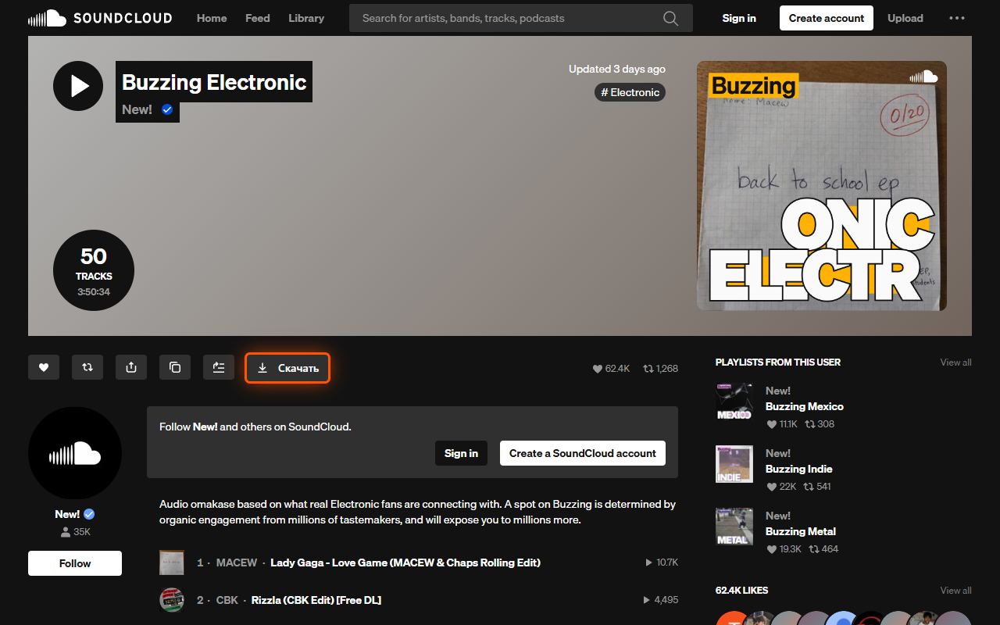
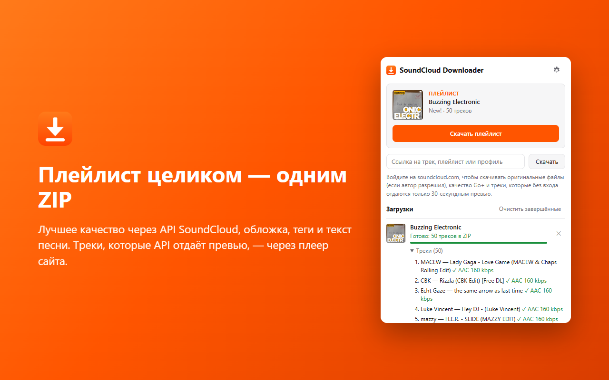
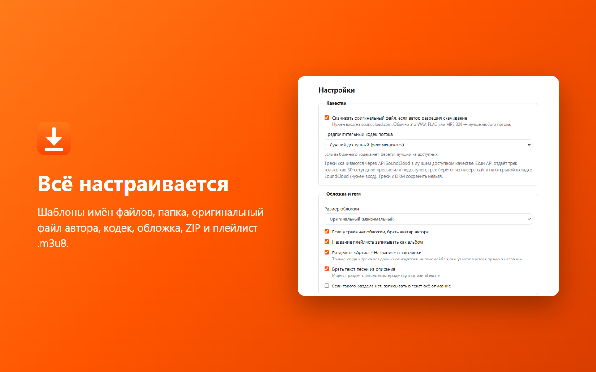

<p align="center"></p>

<h1 align="center">SoundCloud Downloader</h1>

<p align="center">
Бесплатное расширение для Chrome и Firefox: скачивает треки, альбомы, плейлисты и все треки профиля с soundcloud.com
в лучшем доступном качестве — с обложкой, тегами и текстом песни.
</p>

<p align="center">
<a href="../../releases/latest">Скачать</a> ·
<a href="#установка">Установка</a> ·
<a href="#сборка-из-исходников">Сборка</a> ·
<a href="docs/STORE.md">Публикация в магазинах</a> ·
<a href="CHANGELOG.md">Изменения</a>
</p>



## Возможности

- **Кнопка «Скачать»:**
  - на страницах треков, плейлистов и альбомов;
  - у каждого трека в ленте, поиске и списках;
  - в шапке подборок Discover, миксов и чартов;
  - в нижнем плеере (скачивает трек, который сейчас играет).
- **Лучшее качество:** оригинальный файл автора (WAV/FLAC/MP3 320), если он разрешил скачивание, или лучший поток SoundCloud (обычно AAC 160 kbps, с Go+ до 256 kbps). Кодек можно выбрать в настройках.
- **Обложка и теги** для MP3, M4A, FLAC, Ogg/Opus и WAV: исполнитель, название, альбом, год, жанр, номер трека, комментарий со ссылкой. Текст песни берётся из описания трека.
- **Плейлисты, альбомы и профили** скачиваются одним ZIP: треки лежат прямо в архиве, с `cover.jpg` и плейлистом `.m3u8`. Можно сохранять и обычной папкой.
- **Окно расширения:**
  - вставка ссылки, в том числе короткой `on.soundcloud.com/…`;
  - очередь загрузок с прогрессом;
  - кнопки «Повторить» и «Отмена»;
  - пункт «Скачать с SoundCloud» в контекстном меню.
- **Шаблоны имён** файлов и папок, параллельные загрузки, работа в Chrome, Edge, Яндекс Браузере, Opera, Brave и Firefox.



## Откуда берётся звук

Для каждого трека:

1. **API SoundCloud** — основной путь. Используется тот же API, что и у сайта. Если вы вошли на soundcloud.com, запросы идут с вашей сессией. Скачивается оригинальный файл, если автор разрешил, а иначе лучший полный поток.
2. **Плеер сайта** — запасной путь. Используется, если API отдаёт трек только 30-секундным превью без действующей сессии (например, расширение не видит ваш вход) или если загрузка через API сорвалась. Расширение запускает трек на открытой вкладке SoundCloud без звука, берёт ссылку на поток, которую получил плеер, и ставит плеер на паузу. Для этого нужен вход на soundcloud.com.
3. **Если API уже работал с вашей сессией и всё равно получил превью** (трек Go+, а подписки нет), плеер получил бы то же превью. Расширение сразу пишет причину и плеер не трогает.
4. **Треки с DRM** (полная версия только в зашифрованном виде) сохранить нельзя никаким способом. Расширение так и сообщает.

Если API не может открыть ссылку, данные берутся со страницы SoundCloud, а треки — через плеер.

## Установка

Готовые архивы лежат в [Releases](../../releases/latest).

### Chrome, Edge, Яндекс Браузер, Opera, Brave

1. Скачайте `soundcloud-downloader-chrome-<версия>.zip` и распакуйте его в постоянную папку, например `Документы\SoundCloud Downloader`. Не удаляйте эту папку: браузер загружает расширение из неё.
2. Откройте страницу расширений:
   - Chrome: `chrome://extensions`
   - Edge: `edge://extensions`
   - Яндекс Браузер: `browser://extensions`
   - Opera: `opera://extensions`
   - Brave: `brave://extensions`
3. Включите **«Режим разработчика»**.
4. Нажмите **«Загрузить распакованное расширение»** и выберите распакованную папку (в ней лежит `manifest.json`).
5. Закрепите значок на панели и обновите открытые вкладки SoundCloud.

**Как обновить:** распакуйте новую версию в ту же папку с заменой файлов, нажмите «Обновить» на карточке расширения и перезагрузите вкладки SoundCloud.

Если расширение опубликовано в Chrome Web Store, его можно поставить прямо из магазина (см. [docs/STORE.md](docs/STORE.md)).

### Firefox

- **Подписанный `.xpi`** (появляется в релизах, если настроена подпись): откройте файл в Firefox и подтвердите установку. Расширение ставится постоянно.
- **Без подписи, временно:** откройте `about:debugging#/runtime/this-firefox` → «Загрузить временное дополнение…» → выберите `soundcloud-downloader-firefox-<версия>.zip`. Расширение работает до перезапуска браузера.

### Требования

- Chrome/Chromium 116+ или Firefox 128+.
- Вход на soundcloud.com не обязателен. Без входа большинство треков скачивается через API. Вход нужен для оригинальных файлов, качества Go+ и запасного пути через плеер.

## Настройки



Значок расширения → шестерёнка. В шаблонах имён доступны поля: `{artist}`, `{title}`, `{album}`, `{year}`, `{genre}`, `{index}`, `{playlist}`, `{playlistArtist}`, `{uploader}`, `{id}`. Символ `/` в шаблоне папки создаёт вложенные папки.

## Ограничения

- **DRM.** Треки, которые SoundCloud отдаёт только в зашифрованном виде, не сохраняются.
- **Go+.** Для треков Go+ без подписки доступно только 30-секундное превью. Его расширение не сохраняет.
- **Плеер на вкладке.** Когда трек скачивается через плеер, воспроизведение на этой вкладке SoundCloud прерывается: плеер переключается на этот трек и встаёт на паузу.
- **Язык.** Интерфейс только на русском.

## Сборка из исходников

Нужен Node.js 20 или новее. Зависимостей нет.

```bash
git clone https://github.com/KROU4/soundcloud-downloader.git
cd soundcloud-downloader
npm test
node tools/build.mjs
```

- `npm test` запускает юнит-тесты (`node:test`).
- `node tools/build.mjs` синхронизирует `firefox/` с `chrome/` и складывает архивы в `dist/`.

Для разработки загрузите папку `chrome/` как распакованное расширение (или `firefox/` через `about:debugging`) и после правок нажимайте «Обновить».

| Команда | Что делает |
|---|---|
| `npm test` | Юнит-тесты: выбор источника, HLS, теги, имена файлов, ZIP. |
| `npm run check` | Проверяет, что `firefox/` совпадает с `chrome/`, а версии во всех манифестах и `package.json` одинаковые. |
| `npm run build` | Синхронизация и архивы `dist/soundcloud-downloader-{chrome,firefox}-<версия>.zip`. |
| `npm run lint:firefox` | Проверяет Firefox-сборку по правилам addons.mozilla.org (`web-ext lint`). |
| `npm run smoke` | Скачивает трек через настоящий API SoundCloud в `smoke-out/`. Можно передать свои ссылки: `node tools/smoke.mjs <url>…`. |
| `npm run verify` | Запускает `check`, `test` и `lint:firefox` разом. |
| `node tools/store-assets.mjs` | Пересоздаёт скриншоты и промо-картинки для магазинов в `store/`. Нужен Playwright. |

Код меняется только в `chrome/`: это главная копия. В `firefox/` отличаются только `manifest.json` и отсутствие `engine/host.*`. Остальное туда копирует `tools/build.mjs`.

### Устройство

| Файл | Роль |
|---|---|
| `engine/engine.js` | Очередь заданий и выбор источника для каждого трека. Скачивает HLS-поток, собирает `.m4a`, записывает теги и обложку, упаковывает ZIP. |
| `engine/sc-api.js` | Клиент API SoundCloud (`api-v2`). `client_id` берётся из скриптов сайта, сессия — из cookie `oauth_token`. |
| `engine/page-source.js` | Запасной источник: данные и ссылки на поток с открытой вкладки SoundCloud. При необходимости переводит вкладку на нужную страницу и прокручивает список. |
| `content/page-hook.js` | Скрипт в контексте страницы (MAIN world). Запоминает данные, которые загружает сайт, перехватывает ссылку на поток у плеера и нажимает кнопки воспроизведения. |
| `content/content.js` | Добавляет кнопки «Скачать» и передаёт запросы между расширением и `page-hook.js`. |
| `background.js` | Вкладки, загрузки, cookie, настройки. В Chrome движок работает в offscreen-документе `engine/host.html`, в Firefox — в фоновой странице. |
| `lib/` | Запись тегов (ID3, MP4, FLAC, Vorbis/Opus, RIFF), ZIP, HLS, метаданные, имена файлов. |

## Релизы

1. Поднимите версию в `chrome/manifest.json`, `firefox/manifest.json` и `package.json`. Добавьте раздел в `CHANGELOG.md`.
2. Проверьте и закоммитьте:

   ```bash
   npm run verify
   git commit -am "Release 1.2.1"
   ```

3. Поставьте тег:

   ```bash
   git tag v1.2.1
   git push origin main --tags
   ```

4. GitHub Actions ([release.yml](.github/workflows/release.yml)) проверит исходники и версию, прогонит тесты и линт, соберёт архивы и опубликует релиз. Описание релиза берётся из `CHANGELOG.md`.
5. **Подпись для Firefox.** Если в секретах репозитория есть `AMO_JWT_ISSUER` и `AMO_JWT_SECRET` (ключи с addons.mozilla.org), к релизу добавится подписанный `.xpi`. Его можно ставить в любой Firefox.

Каждый push и pull request проверяет [ci.yml](.github/workflows/ci.yml).

## Публикация в магазинах

Пошаговая инструкция для Chrome Web Store, Microsoft Edge Add-ons и Firefox Add-ons (AMO) с готовыми текстами, обоснованиями разрешений и картинками лежит в [docs/STORE.md](docs/STORE.md).

## Конфиденциальность

Расширение не собирает данные и не имеет своих серверов. Запросы идут только на домены SoundCloud. Подробнее — в [PRIVACY.md](PRIVACY.md).

## Лицензия и ответственность

[MIT](LICENSE). Расширение — для личного использования: офлайн-прослушивание музыки, которую вы и так можете слушать на SoundCloud. Уважайте права авторов и [условия использования SoundCloud](https://soundcloud.com/terms-of-use). Проект не связан с SoundCloud.
